<p align="center">
  
</p>

<p align="center">
  <a href="https://github.com/cloudcake/phun/releases/latest"><strong>Download</strong></a>
  &nbsp;&middot;&nbsp;
  <a href="#features">Features</a>
  &nbsp;&middot;&nbsp;
  <a href="#install">Install</a>
  &nbsp;&middot;&nbsp;
  <a href="#the-phun-command">Command line</a>
  &nbsp;&middot;&nbsp;
  <a href="https://github.com/cloudcake/phun/issues">Issues</a>
</p>

Phun runs your PHP applications on your own machine. Every folder you link is
served at its own `.test` address over trusted HTTPS, with the PHP version it
needs, and the databases, cache, search and mail it uses run beside it as
native processes. It is one desktop app for macOS, Linux and Windows, with a
small background service and a `phun` command for the terminal. No Docker, no
virtual machine, and no password for everyday work.

## Download

<!-- latest-release:start -->
Latest release: **[v0.1.2](https://github.com/cloudcake/phun/releases/tag/v0.1.2)**

| System | Installer |
| --- | --- |
| macOS, Apple Silicon | [Phun_0.1.2_apple-silicon.dmg](https://github.com/cloudcake/phun/releases/download/v0.1.2/Phun_0.1.2_apple-silicon.dmg) |
| macOS, Intel | [Phun_0.1.2_intel.dmg](https://github.com/cloudcake/phun/releases/download/v0.1.2/Phun_0.1.2_intel.dmg) |
| Windows 10 and 11, x64 | [Phun_0.1.2_windows-x64-setup.exe](https://github.com/cloudcake/phun/releases/download/v0.1.2/Phun_0.1.2_windows-x64-setup.exe) |
| Linux, x86_64 (Debian, Ubuntu) | [Phun_0.1.2_amd64.deb](https://github.com/cloudcake/phun/releases/download/v0.1.2/Phun_0.1.2_amd64.deb) |
<!-- latest-release:end -->

Phun checks for updates itself and installs them from the app.

## Features



- Link a folder, or park a whole directory, and every project in it is served
  at `name.test`. The web root is found for you.
- HTTPS from Phun's own local certificate authority, trusted by your browsers.
- Each application picks its PHP version; the rest keep theirs.
- Create a new Laravel, WordPress, CodeIgniter, CakePHP, Slim or static
  application from the app, or bring an existing project or a Git repository.
- Share an application on a public URL through Cloudflare Tunnel, for
  webhooks, demos and other devices.
- No admin rights to hand? Every application is also reachable at
  `http://localhost/~name.test`.



- Several PHP versions side by side, each with its own settings and
  extensions.
- MySQL, MariaDB, PostgreSQL, MongoDB, Redis and Meilisearch as native
  services, started with the app.
- Every email your applications send is caught and readable in the Mail
  viewer, rendered, as plain text or as raw source.
- S3-compatible object storage on your machine, for buckets and uploads.
- Queue workers, the scheduler and Reverb per Laravel application.
- Composer, Node.js, Bun, NVM, the Laravel installer and WP-CLI, installed on
  demand without a system package manager.



- A code editor in the app, with highlighting for PHP, Blade, JavaScript,
  TypeScript, Vue, HTML, CSS, JSON, YAML, Markdown and more.
- Laravel-aware completion: your models' attributes and relations, routes,
  views, config, translations and validation rules.
- Problems as you type, checked by the application's own PHP.
- Go to definition, find usages, rename across the project and move classes
  between namespaces with their references updated.
- Formatting with the project's own Pint or Prettier, respecting
  `.editorconfig`.
- Git changes in the gutter and the file tree, with a diff against the last
  commit, and a live preview beside Markdown files.



- Metrics per application: requests, response times, errors, memory and CPU.
- The latest requests with their status, timing and headers, and every
  endpoint's hit count.
- Logs, Artisan, Tinker and a console in a dock at the bottom of the window.
- A database browser with a SQL editor, and for Laravel applications a schema
  canvas that draws your models' relationships and can write new ones.
- Built-in health checks with one-click fixes for anything that fails.

## Install

**macOS.** Open the `.dmg` and drag Phun to Applications. Builds are not yet
notarised, so on first launch right-click Phun and choose Open, or run:

```sh
xattr -cr /Applications/Phun.app
```

Use the Apple Silicon build on M-series Macs and the Intel build on older ones.

**Linux.** Install the `.deb` on Debian, Ubuntu and their derivatives:

```sh
sudo apt install ./Phun_<version>_amd64.deb
```

**Windows.** Run the installer. It is not yet signed, so SmartScreen may warn:
choose More info, then Run anyway.

The first launch walks you through installing a PHP version and trusting
Phun's certificate authority. That step asks for your password once; nothing
after it does.

## The phun command

Everything the app does is also available from the terminal:

```sh
phun link                    # serve the current folder at <folder>.test
phun park ~/Code             # serve every project in a folder
phun use blog <version>      # give blog.test its own PHP version
phun secure blog             # serve blog.test over HTTPS
phun share blog              # give blog.test a public URL
phun status                  # what is running
phun doctor fix              # check the setup and repair what it safely can
```

Run `phun --help` for the full list.

## Why Phun is closed source

Phun holds more trust on your machine than most apps. It installs a
certificate authority your browsers trust, a DNS resolver for `.test`, and a
small privileged helper for the few steps that need your password. Keeping the
source closed keeps that trust in one place:

- **One origin for privileged code.** Every installer comes from this
  repository's releases, built by a single pipeline from a single codebase, so
  you always know where the code holding a certificate authority on your
  machine came from.
- **Free, without strings.** Phun costs nothing and needs no account. A closed
  codebase is what lets a small team keep it that way, with our time going into
  the app and your issues rather than into running a public project.
- **Your feedback still shapes it.** Every issue filed here is read, and the
  roadmap follows what people run into.

## Feedback

Found a bug or have an idea? [Open an issue](https://github.com/cloudcake/phun/issues).
For a security problem, please use
[private vulnerability reporting](https://github.com/cloudcake/phun/security/advisories/new)
instead.

<p align="center"><sub>Phun is made by Cloudcake.</sub></p>
